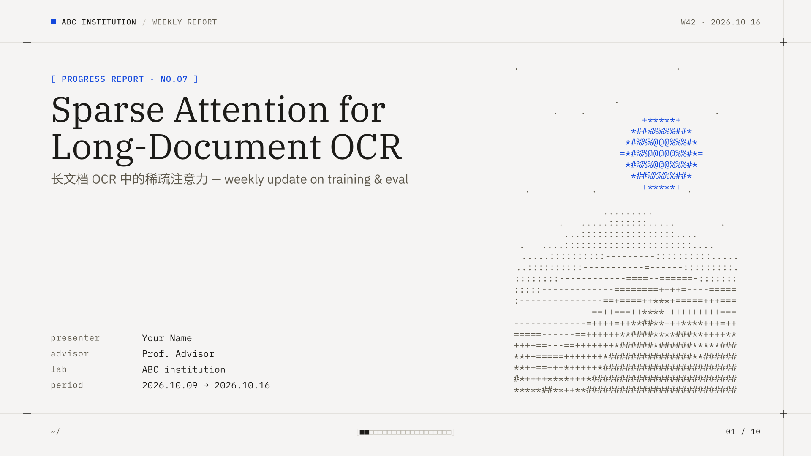
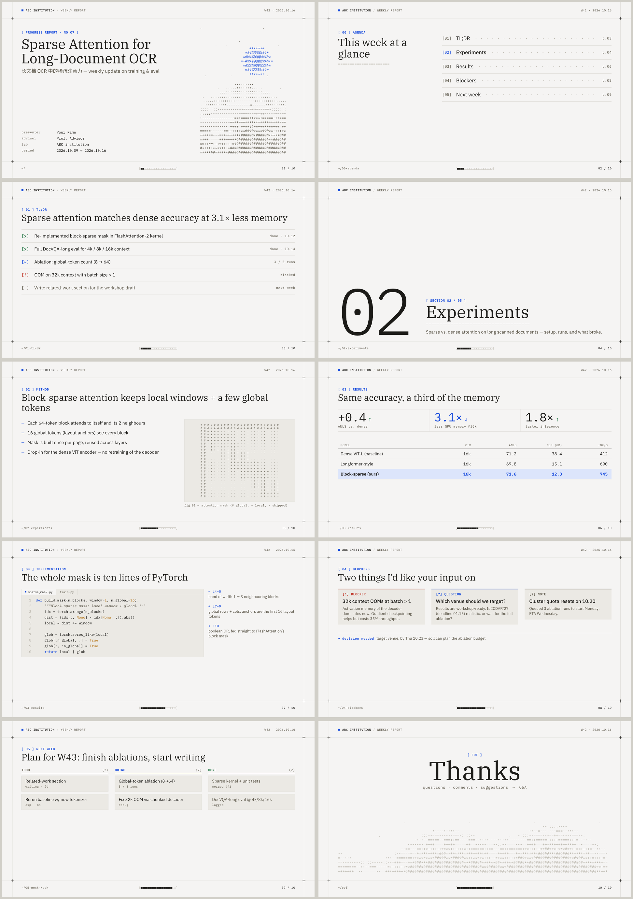
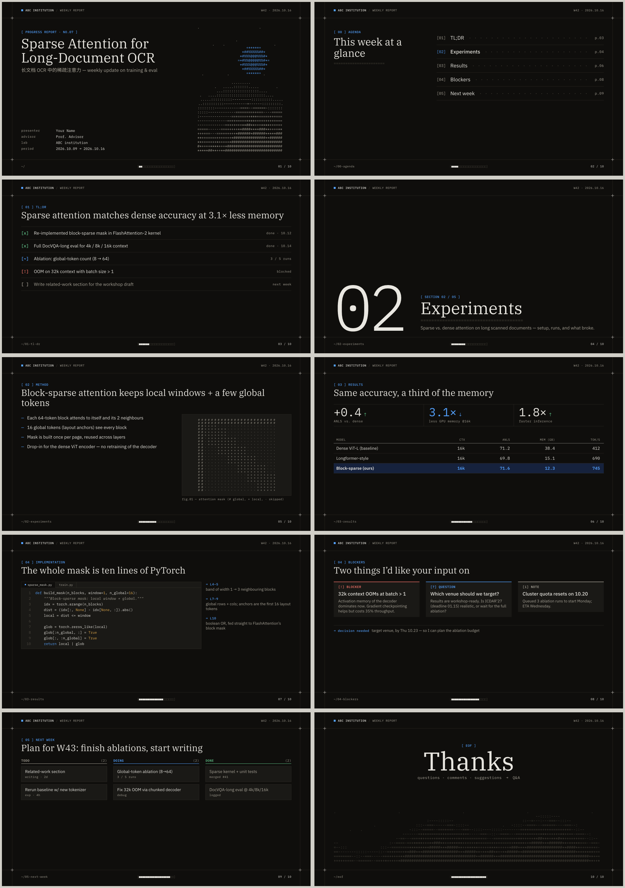
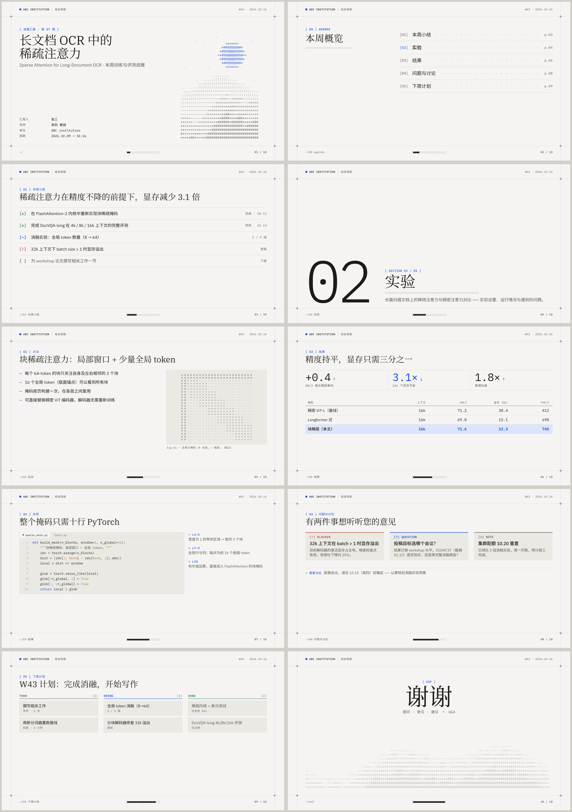
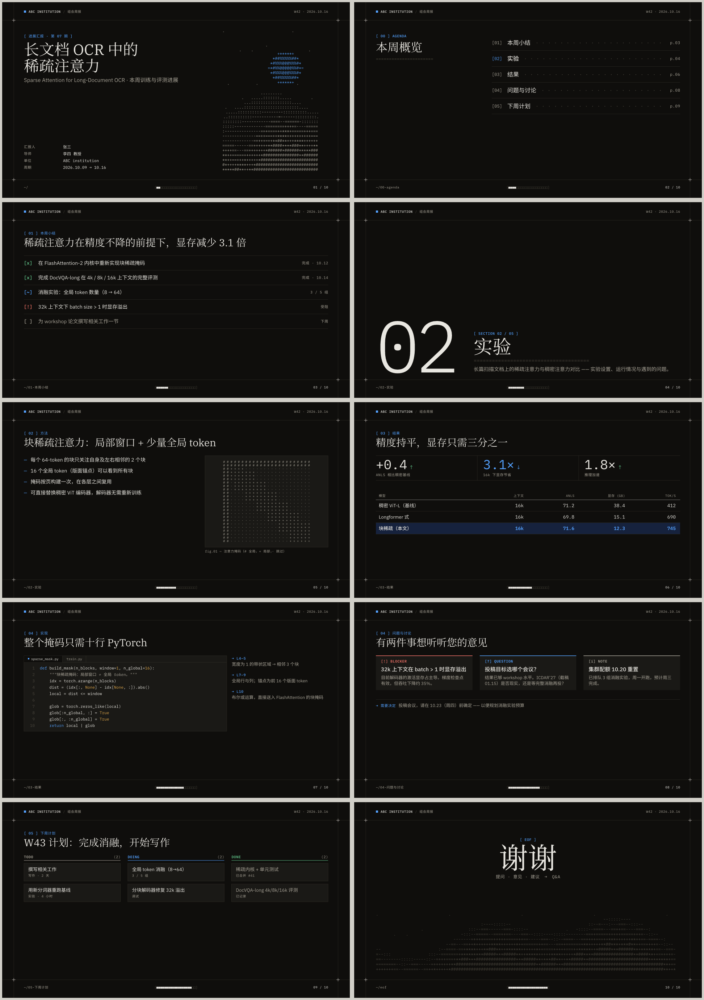

# ascii-weekly

A [Touying](https://github.com/touying-typ/touying) slide theme for weekly research-progress reports. It combines the warm paper, IBM Plex type and hairline grid of [zed.dev](https://zed.dev) with the mono chrome, `[bracket]` labels and ASCII art of [ascii.rest](https://ascii.rest). It comes in light and dark versions and handles mixed Chinese and English text.



| light | dark |
|---|---|
|  |  |
|  |  |

Sample PDFs: [light](examples/light.pdf) · [dark](examples/dark.pdf) · [中文 light](examples/zh-light.pdf) · [中文 dark](examples/zh-dark.pdf)

## Install

Typst loads unpublished packages from its local package directory, so clone the repo straight into it:

```sh
# Linux
git clone https://github.com/Ziqi-Yang/typst-ascii-slides-theme \
  ~/.local/share/typst/packages/local/ascii-weekly/0.1.0
# macOS:   ~/Library/Application Support/typst/packages/local/ascii-weekly/0.1.0
# Windows: %APPDATA%\typst\packages\local\ascii-weekly\0.1.0
```

Then start a report from the template:

```sh
typst init @local/ascii-weekly:0.1.0 my-report
cd my-report
typst watch --font-path ~/.local/share/typst/packages/local/ascii-weekly/0.1.0/fonts main.typ
```

### Fonts

Typst does not load fonts from packages. Either install IBM Plex Sans, Serif and Mono system-wide, or pass `--font-path <repo>/fonts` as shown above; the repo ships the OFL-licensed TTFs. Chinese text falls back to **Source Han Sans/Serif/Mono SC**, or to Noto CJK SC.

Requirements: **Typst ≥ 0.15** (for the variable IBM Plex Sans) and Touying 0.8.0, which is downloaded automatically.

## Weekly use

```typst
#import "@local/ascii-weekly:0.1.0": *

#show: ascii-weekly-theme.with(
  dark: false,                    // true → dark terminal palette for the whole deck
  section-slides: false,          // true → a section slide for every `= heading`
  config-info(
    title: [...], subtitle: [...], author: [...], advisor: [...],
    institution: [ABC institution], report: [\[ PROGRESS REPORT · NO.08 \]],
    week: "W43", date: datetime.today(), period: [10.16 → 10.23],
  ),
)

#title-slide()
#agenda-slide(current: 2)   // lists the `= headings` and highlights #2

= Results                   // section: drives the kicker "[ 03 ] RESULTS" and the footer path
== Same accuracy, a third of the memory   // slide title
...
#ending-slide()
```

[`template/main.typ`](template/main.typ) is a full English report using every layout, and [`examples/zh.typ`](examples/zh.typ) is the same report in Chinese. To get a dark version of either deck, add `--input dark=true` when compiling.

## Slides

| function | what it is |
|---|---|
| `title-slide(meta:, art:)` | Cover with title, metadata and an ASCII landscape |
| `agenda-slide(title:, current:)` | Agenda built from sections, with dotted leaders and slide numbers |
| `section-slide[desc]` | Huge section number, title and a `====` rule |
| `slide(kicker:, title:, crumb:, dark:, composer:)` | Standard content slide (`== heading` gives the title) |
| `focus-slide(dark:)[...]` | A single statement |
| `ending-slide(title:, subtitle:, dark:)` | `Thanks` over an ASCII horizon |

Every slide follows the deck palette. Pass `dark: true` or `dark: false` to flip a single slide.

## Components

| function | use |
|---|---|
| `status-list(("done"\|"doing"\|"todo"\|"blocked", body, meta), ...)` | TL;DR checklist (`[x] [~] [ ] [!]`) |
| `metrics((value:, label:, arrow:, tone:, highlight:), ...)` | Row of headline numbers |
| `result-table(header: (...), highlight: n, row, ...)` | Hairline results table; row `n` set in accent |
| `code-window(file:, tabs:)[```py ...```]` | Zed-like editor window with line numbers |
| `notes-list(("L4–5", [...]), ...)` | `→ ref` annotations next to code |
| `callout(kind: "blocker"\|"question"\|"note"\|"idea", title:)[...]` | Tagged box |
| `side-by-side(a, b, c)` | Equal-width columns |
| `ask(label:)[...]` | `→ decision needed` line |
| `kanban(todo:, doing:, done:)` | Next-week board; cards are `(title, meta)` |
| `figure(pane(...), caption: [...])` | Figure with a `fig.01 — …` caption |
| `ascii-landscape(...)`, `ascii-bar(ratio)`, `ascii-rule()`, `kicker()`, `mono()` | Small building blocks |

Touying features such as `#pause`, `#meanwhile`, `#speaker-note[...]` and `config-common(handout: true)` work as usual.

## Layout

```
lib.typ        package entrypoint (re-exports Touying + the theme)
src/           ascii-weekly.typ (slides, theme) · components.typ · tokens.typ · code-*.tmTheme
template/      main.typ, copied by `typst init`
examples/      zh.typ (Chinese demo), rendered PDFs and previews
fonts/         IBM Plex Sans / Serif / Mono (OFL)
design/        main.pen (Pencil source), png/ and ascii-weekly-design.pdf renders
```

Colors and fonts live in `src/tokens.typ`. Their values match the Pencil design in `design/main.pen`, scaled so that 1920×1080 px maps to 960×540 pt.

To work on the theme itself, symlink the clone into the package path (`ln -s $PWD ~/.local/share/typst/packages/local/ascii-weekly/0.1.0`) and rebuild the examples:

```sh
typst compile --font-path fonts template/main.typ examples/light.pdf
typst compile --font-path fonts --input dark=true template/main.typ examples/dark.pdf
typst compile --root . --font-path fonts examples/zh.typ examples/zh-light.pdf
```

## License

The code is under the [MIT](LICENSE) license. The IBM Plex fonts in `fonts/` are © IBM Corp. and licensed under the [SIL Open Font License 1.1](fonts/OFL.txt). zed.dev and ascii.rest are visual inspirations only; this project is not affiliated with either.
